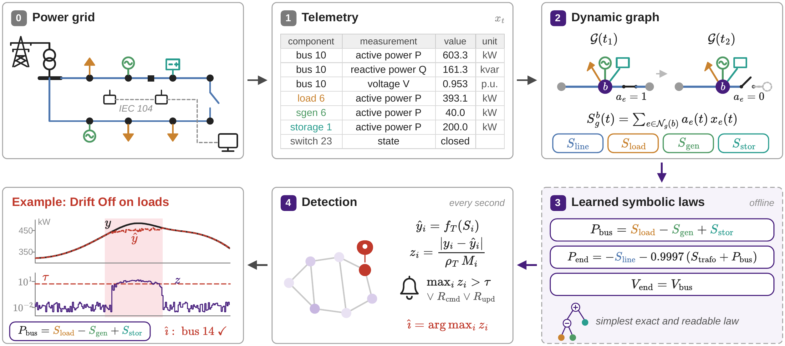
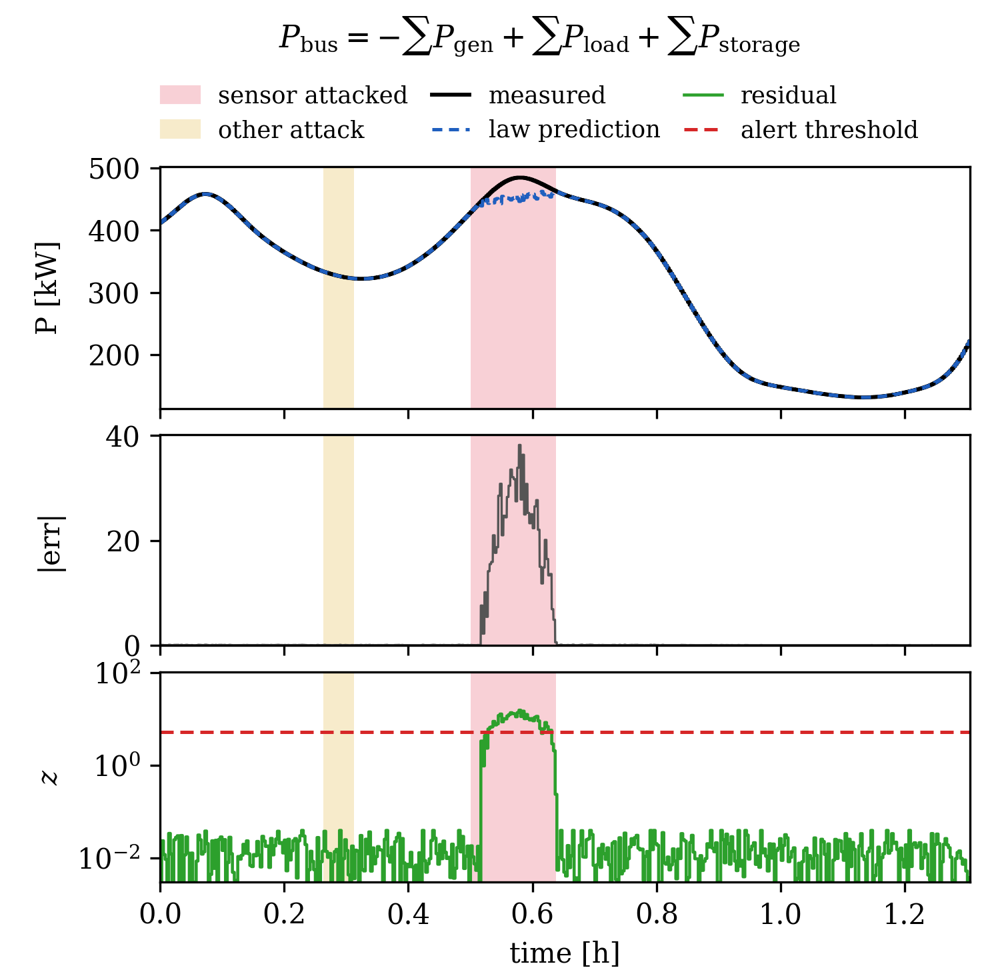

# SyRe

Code for **Follow the Power: Symbolic and Readable Intrusion Detection for Reconfigurable Power Networks**.

Power must balance at every bus. SyRe learns that fact from normal operation, as short equations
that a grid operator can read. If someone tampers with the telemetry, an equation stops holding,
and the bus where it breaks shows where to look.



The grid's measurements arrive over IEC 104 (0, 1). At every second, SyRe builds a graph of the grid
as it is wired right now. Open switches drop their lines, and each bus sums up what is connected to it (2).
Offline, symbolic regression finds the simplest exact law for each kind of quantity. It finds the power
balances and "a line end sees its bus voltage" (3). Online, every law is checked at every bus and line end.
An alarm goes off when one breaks by more than anything seen in training, or when one of two rules on the
control-center log fires. The broken law tells you where the attack is (4).

## Results

On the [Sherlock](https://doi.org/10.5281/zenodo.18467070) dataset, counted as in the Sherlock paper:

| | Attacks detected | False alarms | Mean time to detect |
|---|---|---|---|
| 01-Basic | 15 of 18 | 7 | 50 s |
| 02-Semiurban | 25 of 29 | 3 | 52 s |

Every false alarm starts during a planned operator action (maintenance, switching, a transformer tap step)
and lasts 1 to 10 seconds.

## Try it

```bash
pip install -e .

mkdir -p data && cd data
curl -L -o 01-Basic.zip https://zenodo.org/api/records/18467070/files/01-Basic.zip/content
unzip -q 01-Basic.zip && cd ..

syre run configs/01-Basic.toml
```

It takes about half a minute. The output ends with a check against the paper:

```
same as the paper, second by second: laws alarm yes, command rule yes, update rule yes
```

For the larger grid, download `02-Semiurban.zip` (6.4 GB) and run `configs/02-Semiurban.toml`.
It needs about 4 minutes and 12 GB of RAM.

To see one law at work around one attack:

```bash
syre plot configs/01-Basic.toml --attack 23 --law "bus_P bus.14"
```



Someone drifts the load readings at bus 14 (pink). The power balance there breaks and crosses the
threshold within two minutes. During the attack on bus 10 earlier (yellow), the same law stays quiet.

## Learning the laws yourself

The laws in `configs/` are the ones from the paper. To learn them again from the training data:

```bash
pip install -e ".[fit]"
syre fit configs/01-Basic.toml
```

This runs PySR for up to 30 minutes per quantity type. Because the search stops on a time limit, a new run
can land on slightly different coefficients.

## What is where

```
configs/       one file per grid: laws, thresholds, settings
syre/data.py   telemetry, receive times, control-center log, attack windows
syre/grid.py   grid map from the dataset drawing, neighbour sums
syre/laws.py   residuals and the alarm threshold
syre/rules.py  the two control-center rules
syre/score.py  counting detections
syre/fit.py    PySR search and law selection
syre/plot.py   the trace figure
```

Everything is learned and calibrated on training data. Attack labels are used only to count detections.

Code: MIT license. Dataset: CC BY 4.0, Wagner et al.
